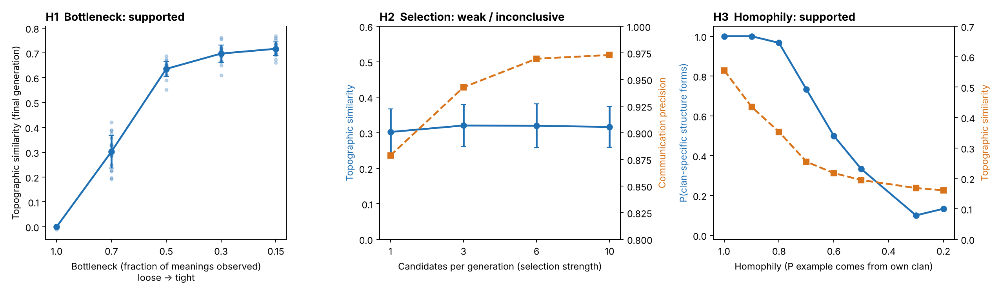

# whale-alphabet-emergence

**Why might sperm whale codas be combinatorial? A small iterated-learning simulation.**

Sperm whale codas were recently shown to combine four features (rhythm, tempo, rubato, ornamentation) into a large signal inventory (Sharma et al., 2024, *Nat. Commun.*). This project asks a narrow modelling question: **which cultural-transmission pressures are sufficient for such "alphabet-like" structure to emerge in an iterated-learning model?** It is a symbolic toy model (no audio), meant to test plausibility of mechanisms, not to reconstruct what happened in real sperm whales.

> Status: undergraduate project (L3, Université Claude Bernard Lyon 1), **not peer-reviewed**. Feedback from people who work on sperm whale communication is very welcome — see [Limitations](#limitations).

## Model in brief

- A **meaning** is (vocal clan, social unit, individual): 6 × 5 × 11 = 330 meanings (illustrative sizes, not measured values).
- A **signal** is a 6-letter string (alphabet of 6), one 2-letter slot per dimension.
- Each generation, a new agent sees only a fraction of the previous generation's signals (the **bottleneck**), induces *chunks* (value → slot) by majority rule, and must produce signals for all 330 meanings, with 5 % copy noise.
- **Compositionality** = topographic similarity (Spearman correlation between meaning distance and signal distance). Random signals ≈ 0.

## Results (20–30 random seeds per condition, 40 generations)

| | Mechanism tested | Result |
|---|---|---|
| **H1** | Tighter transmission bottleneck | **Supported.** Topographic similarity 0.00 (no bottleneck) → 0.30 → 0.64 → 0.70 → 0.72 (bottleneck 1.0 → 0.15); all steps up to 0.3 significant (Mann–Whitney, Bonferroni), then a plateau. |
| **H2** | Selection for communication precision (best of N learners kept) | **Weak / inconclusive.** Precision rises 0.88 → 0.97, but at 40 generations compositionality does not change detectably (0.30 vs 0.32; p = 0.18–0.25, n = 20). An exploratory 150-generation run shows a small effect (0.495 → 0.521, p = 0.022, uncorrected). |
| **H3** | Homophily (learning mostly from own clan) | **Supported within the model.** As homophily drops from 1.0 to 0.2, clan-specific structure becomes rarer (P(forms) 1.00 → 0.13) and compositionality falls (0.56 → 0.16); the transition lies between homophily 0.8 and 0.5. |



H1 reproduces a known result of the iterated-learning literature (Kirby et al.) in a sperm-whale-inspired meaning space; H2/H3 are the exploratory parts.

## Run it

```bash
python3 -m venv venv && source venv/bin/activate
pip install -r requirements.txt
python3 run_h1_bottleneck.py      # ~1 min  -> results/h1/
python3 run_h2_selection.py       # ~1 min  -> results/h2/
python3 run_h3_homophily.py       # ~5 min  -> results/h3/
python3 run_h2_long.py            # ~3 min  -> results/h2/ (supplementary, 150 generations)
python3 make_summary_figure.py    # -> results/summary.png
```

Runs are seeded and deterministic; `python3 test_model.py` runs sanity checks. Core model: [`iterated_learning.py`](iterated_learning.py).

## Limitations

- Symbolic signals only: no acoustics, and the segmentation into 3 slots is imposed, not discovered.
- The "meaning" space (clan/unit/individual identity) is an assumption; what codas actually encode is largely unknown. Clan/unit/individual counts are modelling choices (real Dominica units have 4–12 members, Gero et al. 2016).
- H2 and H3 were each tested at a single bottleneck value; H2 shows at most a small effect and needs longer runs to be assessed properly.

## Documentation

- 📄 [Full technical report (English, PDF)](docs/report_en.pdf) — methods, statistics, design pitfalls found and fixed, limitations.
- 📄 [Rapport détaillé (français, PDF)](docs/report_fr.pdf)

## References

- Sharma P. et al. (2024). Contextual and combinatorial structure in sperm whale vocalisations. *Nat. Commun.* 15, 3617.
- Gero S., Whitehead H., Rendell L. (2016). Individual, unit and vocal clan level identity cues in sperm whale codas. *R. Soc. Open Sci.* 3, 150372.
- Rendell L., Whitehead H. (2003). Vocal clans in sperm whales. *Proc. R. Soc. B* 270.
- Cantor M. et al. (2015). Multilevel animal societies can emerge from cultural transmission. *Nat. Commun.* 6.
- Kirby S., Cornish H., Smith K. (2008). Cumulative cultural evolution in the laboratory. *PNAS* 105.

## License

MIT

*This is my project. Claude (an AI assistant) helped with the code and writing; the question, the decisions and the conclusions are mine.*
