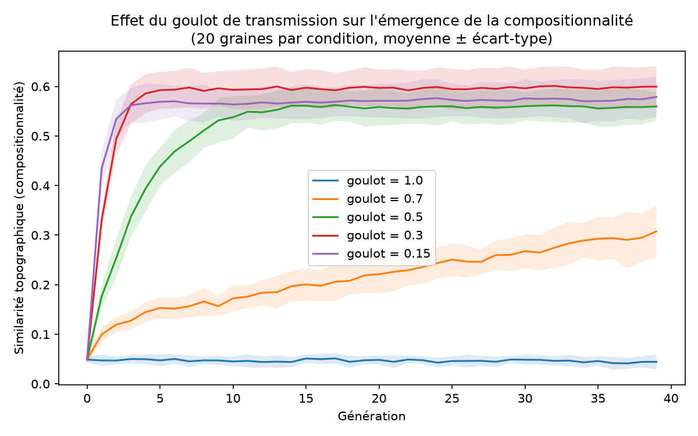
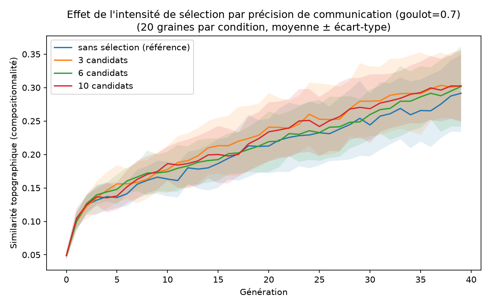
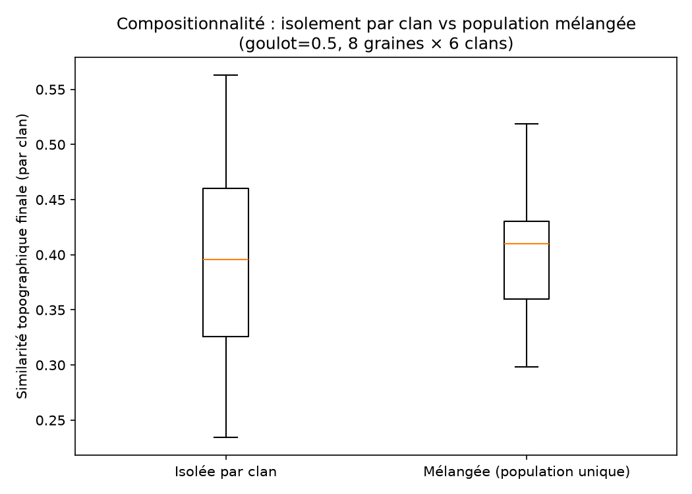
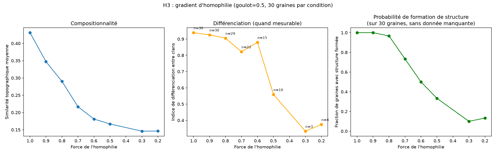

# Pourquoi un « alphabet » plutôt que des « mots » ? Trois hypothèses testées par simulation

**Sperm whale communication — projet de simulation évolutive et culturelle sur la structure combinatoire des codas de cachalot**

---

## Résumé

En 2024, des chercheurs ont découvert que les cachalots ne communiquent pas avec un simple stock de sons figés, mais avec un système où de petits éléments se combinent comme des briques pour produire une grande variété de signaux — un peu comme un alphabet. Ce projet teste, par simulation informatique, trois mécanismes qui pourraient expliquer pourquoi un tel système émergerait.

| Hypothèse | Mécanisme testé | Verdict |
|---|---|---|
| **H1** | Goulot de transmission | **Confirmée**, gradient net, plafond au-delà d'un certain seuil |
| **H2** | Sélection par précision de communication | **Réfutée**, robustement |
| **H3** | Homophilie et différenciation par clan | **Confirmée**, seuil de transition localisé précisément |

Ce document est écrit pour être compréhensible par quelqu'un qui ne connaît rien aux cachalots ni à la programmation. Chaque terme technique est défini la première fois qu'il apparaît, avec un exemple concret. Les figures réelles de chaque expérience sont incluses, ainsi que le détail des erreurs de conception rencontrées en cours de route — parce qu'elles font partie de la démarche scientifique autant que les résultats eux-mêmes.

---

## 1. Contexte scientifique : la communication du cachalot

### 1.1 Le cachalot et ses clics

Le cachalot (*Physeter macrocephalus*) est le plus grand des odontocètes (cétacés à dents). C'est un animal profondément social : les femelles et leurs petits vivent en groupes stables toute leur vie, tandis que les mâles adultes partent vivre seuls ou en groupes de mâles une fois matures.

Le cachalot ne produit pas de sons continus comme le chant de la baleine à bosse. Il communique par des **clics** — des impulsions sonores très brèves (de l'ordre de la milliseconde), produites en frappant l'air à l'intérieur d'un organe rempli d'un liquide huileux appelé le **spermaceti**, situé dans son énorme tête. Ces clics servent à deux usages bien distincts :
- **L'écholocalisation** : des trains de clics réguliers et rapprochés, utilisés pour "voir" par le son en profondeur, notamment pour chasser des calmars dans l'obscurité totale.
- **Les codas** : de courtes séquences de clics, structurées et volontairement produites pendant les interactions sociales en surface — c'est l'objet de ce projet.

### 1.2 Qu'est-ce qu'une coda, précisément ?

Une **coda** est une courte suite de clics (typiquement entre 3 et 40 clics) séparés par des silences dont la durée varie. On la décrit techniquement à travers l'**intervalle inter-clics** (ICI, pour *inter-click interval*) : le temps qui sépare un clic du suivant.

Par exemple, une coda à 5 clics a 4 intervalles inter-clics (le temps entre le clic 1 et le clic 2, entre le clic 2 et le clic 3, et ainsi de suite). Les biologistes utilisent depuis les années 1990 une notation simple pour décrire ces intervalles, par exemple **« 1+1+3 »** : elle indique le nombre de clics regroupés par intervalles de durée similaire — ici, un premier groupe, un deuxième groupe, puis un groupe de trois clics rapprochés.

### 1.3 Rhythm, tempo, rubato, ornementation : les quatre paramètres découverts en 2024

C'est ici que se situe la découverte centrale de ce projet (Sharma et al., 2024, projet CETI). Avant cette étude, on classait les codas dans un catalogue d'environ 21 « types » fixes, chacun étant traité comme une unité indépendante des autres. L'étude montre que chaque coda résulte en réalité de la combinaison de **quatre paramètres semi-indépendants**. Voici chacun d'eux, défini précisément, avec un exemple chiffré construit pour illustrer la définition (les chiffres de l'exemple sont pédagogiques, pas des mesures réelles d'une coda précise).

**Le tempo** est la durée totale de la coda — la somme de tous ses intervalles inter-clics. Concrètement, si une coda a 4 intervalles de 0,2 s ; 0,2 s ; 0,2 s ; et 0,6 s, son tempo (sa durée totale) est de 0,2+0,2+0,2+0,6 = **1,2 seconde**. Les chercheurs ont trouvé que les durées de codas ne se répartissent pas au hasard, mais se regroupent autour de quelques valeurs typiques (des « types de tempo »).

**Le rythme** est la structure *relative* des intervalles, indépendante de la durée totale — on l'obtient en divisant chaque intervalle par la durée totale de la coda. Pour la coda de l'exemple ci-dessus (intervalles 0,2 / 0,2 / 0,2 / 0,6 s, durée totale 1,2 s), le rythme est la proportion de chaque intervalle : 0,2/1,2 ≈ 0,17 ; 0,17 ; 0,17 ; 0,6/1,2 = 0,5. Deux codas peuvent donc avoir exactement le même rythme (les mêmes proportions) tout en ayant des tempos très différents — imaginez la même mélodie jouée deux fois, une fois lentement et une fois vite : les proportions entre les notes restent identiques, seule la vitesse change. Les chercheurs ont identifié environ **18 types de rythme** distincts chez le cachalot.

**Le rubato** (terme emprunté au vocabulaire musical, où il désigne une liberté rythmique où le tempo s'accélère ou ralentit légèrement sans casser la pulsation) décrit ici la façon dont la durée d'une coda varie progressivement d'un échange à l'autre entre deux cachalots qui « discutent ». Deux codas voisines dans une conversation ont des durées plus proches l'une de l'autre que deux codas du même type mais séparées dans le temps — comme une valse qui accélère ou ralentit progressivement tout en gardant la même relation entre ses temps. C'est un ajustement fin, en temps réel, au rythme du partenaire de conversation.

**L'ornementation** est l'ajout occasionnel d'un clic supplémentaire à la fin d'une coda, qui ne fait pas partie du rythme ou du tempo de base. Ce clic en plus ne se produit pas au hasard : il apparaît préférentiellement au début et à la fin d'un échange, ou quand un cachalot rejoint une conversation déjà commencée — un peu comme des mots de liaison en français (« bref », « du coup », « voilà ») qui ponctuent une conversation sans en changer le contenu.

### 1.4 Pourquoi cette combinaison change tout

Avant 2024, on pensait que le cachalot disposait d'environ 21 signaux figés. En laissant le rythme et le tempo se combiner librement (indépendamment de rubato et ornementation, qui ajoutent une couche supplémentaire de variation contextuelle), les chercheurs ont trouvé **au moins 143 combinaisons rythme × tempo** distinctes — et en tenant compte de toutes les variations combinées (y compris rubato et ornementation), plus de **8700 codas différentes** ont été recensées dans leur jeu de données. C'est la différence entre un stock de 21 mots tout faits, et un petit alphabet de pièces qu'on peut assembler pour créer un nombre bien plus grand de signaux.

### 1.5 La question évolutive que ça soulève

Pourquoi la nature aurait-elle développé un système à pièces recombinables plutôt qu'un simple stock de signaux figés ? Ce n'est pas une question à laquelle on peut répondre en observant seulement les cachalots d'aujourd'hui — il faut tester, sous forme d'hypothèses, des mécanismes qui pourraient expliquer *pourquoi* un tel système apparaîtrait et se maintiendrait au fil des générations. C'est l'objet de ce projet.

### 1.6 Trois hypothèses, un seul modèle de base

- **H1** teste si le simple fait de ne recevoir qu'une information partielle d'une génération à l'autre (le goulot de transmission) suffit.
- **H2** teste si la sélection, parmi plusieurs individus, de celui qui communique le plus précisément accélère les choses.
- **H3** teste si l'apprentissage préférentiel au sein de son propre groupe social (l'homophilie) favorise une différenciation entre groupes, en plus ou à la place de la compositionnalité.

---

## 2. Méthode commune à toutes les hypothèses

### 2.1 Pourquoi un modèle symbolique plutôt que du vrai son

Reproduire fidèlement des clics acoustiques réels (avec leurs intervalles précis, leurs propriétés spectrales, le bruit de l'océan, etc.) est un problème de traitement du signal complexe en soi, indépendant de la question qu'on veut poser ici. Ce projet fait le choix délibéré de **remplacer le signal acoustique par une chaîne de lettres abstraite**, pour isoler la question qui nous intéresse (un mécanisme d'apprentissage et de transmission peut-il faire émerger une structure combinatoire ?) sans se battre en même temps avec la complexité du son réel. C'est une simplification assumée, discutée dans les limites (section 8).

### 2.2 Vue d'ensemble du modèle

On construit un **modèle d'apprentissage itéré** (« iterated learning model »), un outil classique de la linguistique évolutive, utilisé depuis les années 2000 pour étudier comment des structures linguistiques peuvent émerger spontanément d'un processus de transmission culturelle répété.

Le principe général :
1. On définit un ensemble de **« sens »** — des choses qu'un individu pourrait vouloir signaler (détaillé section 2.3).
2. On définit un ensemble de **« signaux »** — des chaînes de lettres représentant, de façon abstraite, ce que serait une coda chez le vrai cachalot (détaillé section 2.4).
3. Une suite de générations d'agents virtuels se transmet ce système : chaque génération apprend à partir d'un échantillon limité (le goulot) de ce qu'a produit la génération précédente, puis doit produire un signal pour *tous* les sens possibles — y compris ceux qu'elle n'a jamais observés.
4. On mesure, à chaque génération, si le système obtenu est « à pièces recombinables » (compositionnel, comme l'alphabet de CETI) ou « figé » (holistique, comme l'ancien catalogue de 21 types).

### 2.3 L'espace des sens : que représente un « sens » chez notre cachalot virtuel ?

Un sens est un triplet de nombres — par exemple `(2, 0, 4)`. Chacune des 3 positions (qu'on appelle des « dimensions ») correspond à un niveau d'identité social réellement documenté chez le cachalot, décrit dans Gero, Whitehead & Rendell (2016). Le « sens » qu'un cachalot virtuel doit communiquer, dans ce modèle, est donc une question d'identité : ***qui suis-je***, décomposée sur trois échelles emboîtées, de la plus large à la plus étroite.

**Dimension 0 : le clan vocal.** Chez le vrai cachalot, un « clan » n'est pas un groupe qui vit ensemble ni une famille au sens génétique — c'est un regroupement culturel, défini uniquement par le fait de partager le même répertoire de codas, un peu comme un groupe ethnolinguistique humain défini par sa langue plutôt que par sa localisation géographique. Un clan peut réunir plusieurs milliers d'individus dispersés sur des milliers de kilomètres, qui ne se rencontreront jamais tous, mais qui « parlent le même dialecte » de codas. Rendell & Whitehead (2003) ont comparé les répertoires de codas de 18 unités sociales connues et de 61 rassemblements temporaires, enregistrés dans le Pacifique et les Caraïbes entre 1985 et 2000, et ont montré que ces répertoires se répartissent de façon fiable en **6 clans distincts** — 5 dans le Pacifique, 1 dans les Caraïbes. C'est ce chiffre exact (6) qu'on utilise pour cette dimension : ce n'est pas un choix arbitraire, c'est directement le nombre de clans réellement recensés dans cette étude de référence.

**Dimension 1 : l'unité sociale.** En dessous du clan, l'« unité sociale » est le groupe de vie réel et quotidien du cachalot — principalement des femelles adultes apparentées et leurs petits, qui voyagent, chassent, et se relaient pour garder les jeunes en surface pendant que les autres plongent chasser en profondeur (les mâles adultes, eux, quittent leur unité natale à la maturité et vivent seuls ou en groupes de mâles). Plusieurs unités sociales partagent le même répertoire de codas et forment ensemble un clan. **On attribue 5 valeurs possibles à cette dimension** : contrairement au nombre de clans, il n'existe pas, dans la littérature, un chiffre unique et définitif pour "le nombre d'unités par clan" (ce nombre varie selon les clans et les régions étudiées) — 5 est donc un choix de modélisation raisonnable plutôt qu'un fait biologique aussi précisément établi que le nombre de clans, et ce point est répété dans les limites (section 8).

**Dimension 2 : l'individu.** À l'intérieur d'une unité sociale, chaque cachalot est un individu distinct, identifiable par les chercheurs sur le terrain via des photographies de la nageoire caudale (chaque cachalot a des marques et encoches uniques) et via la signature acoustique de ses clics (la taille de l'organe qui produit le son varie avec la taille du corps, ce qui modifie légèrement l'intervalle entre clics). **On attribue 11 valeurs possibles à cette dimension**, correspondant à la taille typique d'une unité sociale réelle — de l'ordre d'une dizaine de femelles et de jeunes.

**Au total : 6 clans × 5 unités × 11 individus = 330 sens différents.** Par exemple, le sens `(2, 0, 4)` représenterait : l'individu n°4, dans l'unité sociale n°0, appartenant au clan vocal n°2. Le modèle ne prétend pas que ces numéros correspondent à des clans ou individus réels précis — ils servent à donner à l'espace de sens une taille et une structure hiérarchique directement ancrées dans ce qu'on sait de l'organisation sociale du cachalot, plutôt que des chiffres choisis au hasard.

### 2.4 L'espace des signaux

Un signal est une chaîne de 6 lettres, choisies parmi un alphabet de 6 lettres (`a`, `b`, `c`, `d`, `e`, `f`). Ce signal est divisé en 3 morceaux de 2 lettres chacun — un morceau par dimension du sens (un morceau pour le clan, un pour l'unité, un pour l'individu). Par exemple, le signal `"abcdef"` est composé des morceaux `"ab"`, `"cd"`, `"ef"`.

**Un point de conception important** : le modèle *impose* dès le départ que le signal soit découpé en 3 morceaux à des positions fixes (les 2 premières lettres pour le clan, les 2 suivantes pour l'unité, les 2 dernières pour l'individu). Ce que le modèle ne sait pas d'avance, c'est *quel morceau de lettres correspond à quelle valeur* de quelle dimension — c'est précisément ce que chaque génération doit apprendre ou inventer par elle-même. C'est une simplification par rapport à la réalité, où même la segmentation elle-même devrait en principe être découverte (voir limites, section 8).

### 2.5 Deux mémoires séparées chez chaque agent

Chaque agent virtuel (chaque « génération ») possède deux formes de mémoire distinctes, qui jouent des rôles différents :

- **Le lexique** : une mémorisation exacte, par cœur, des paires (sens, signal) que l'agent a directement observées. C'est une mémoire sans généralisation — un sens déjà vu ressort exactement tel qu'il a été appris, sans qu'aucune règle n'en soit tirée.
- **Les chunks** (mot anglais signifiant « morceau », utilisé tel quel car c'est le terme standard en psycholinguistique pour une unité récurrente apprise) : une table qui associe une dimension et une valeur précise (par exemple « dimension 1 [unité], valeur 3 ») à un morceau de signal réutilisable (par exemple `"cd"`). C'est cette deuxième mémoire qui permet à l'agent de généraliser — de produire un signal pour un sens qu'il n'a *jamais* rencontré, en assemblant des morceaux déjà connus.

### 2.6 Apprendre (la fonction `learn`) — la règle de majorité

Quand un agent reçoit une liste d'exemples (des paires sens-signal observées chez la génération précédente), il fait deux choses :

1. Il mémorise tous ces exemples tels quels dans son lexique (mémorisation par cœur, sans traitement).
2. Pour chaque dimension et chaque valeur possible, il regarde tous les exemples observés qui partagent cette valeur à cette dimension, et compare le morceau de signal qui s'y trouve. **Si une majorité — strictement plus de 50 % — de ces exemples partagent exactement le même morceau**, l'agent retient ce morceau comme un chunk fiable pour cette dimension et cette valeur (il faut au moins deux exemples partageant la valeur pour pouvoir comparer).

**Exemple concret** : imaginons que l'agent observe trois sens partageant la valeur « 3 » à la dimension 0 (le clan) : `(3, 1, 0)` associé au signal `"efcdab"`, `(3, 4, 2)` associé à `"efghij"`, et `(3, 2, 1)` associé à `"efabcd"` (imaginons ici un alphabet un peu plus large pour l'exemple). Les trois signaux commencent par les deux mêmes lettres, `"ef"` — une majorité (ici, la totalité des trois) concorde, donc l'agent retient : « dimension 0, valeur 3 → chunk `"ef"` ».

> **Journal de correction n°1.** La toute première version de cette règle exigeait une correspondance strictement identique entre *tous* les exemples partageant une valeur, sans aucune exception tolérée — une règle d'unanimité plutôt que de majorité. En testant le modèle, on a découvert que cette règle échouait presque systématiquement (0 chunk appris sur 22 possibles, à goulot large), parce qu'un agent peut, sans qu'on l'en empêche, produire des signaux incohérents entre sa mémoire par cœur (le lexique) et ses propres règles générales (les chunks) — voir section 2.9 pour l'explication complète de ce mécanisme. Un diagnostic direct (comparaison de la formation de chunks avec et sans bruit de copie) a confirmé que la cause de cet échec n'était pas le bruit de mutation, mais bien cette incohérence structurelle entre les deux mémoires. La règle de majorité, plus tolérante, corrige le problème sans qu'on ait eu besoin de forcer artificiellement la cohérence de l'agent avec lui-même.

### 2.7 Produire un signal, y compris pour l'inconnu (la fonction `produce`)

Quand on demande à un agent de produire un signal pour un sens donné (que ce sens soit connu ou totalement nouveau pour lui), la logique suit cet ordre :

- **Si l'agent connaît déjà ce sens exact** (il figure dans son lexique) : il ressort le signal mémorisé, avec une petite probabilité (5 %, par caractère) qu'une lettre change accidentellement à la copie. Ce bruit de copie représente, dans le modèle, l'imperfection de reproduction motrice chez le jeune cachalot — le babillage documenté chez les jeunes cachalots (qui babillent environ deux ans avant de produire des clics bien formés) suggère que le problème n'est pas tant que le petit n'entend pas bien sa mère, mais qu'il n'arrive pas encore à reproduire fidèlement ce qu'il a entendu — un phénomène de développement partagé avec de nombreuses autres espèces à apprentissage vocal (Ter Haar et al., 2021).
- **Si l'agent ne connaît pas ce sens** : il tente de le reconstruire morceau par morceau. Pour chaque dimension, s'il possède un chunk fiable pour la valeur correspondante, il le réutilise ; sinon, il **invente** une combinaison de lettres au hasard pour ce morceau, et **la retient immédiatement** dans sa table de chunks — pour que, s'il rencontre à nouveau cette même valeur plus tard (même dans le contexte d'un sens différent), il produise exactement le même morceau plutôt qu'une nouvelle invention. Sans cette cohérence interne au sein d'une même génération, aucun motif stable ne pourrait jamais apparaître pour la génération suivante à observer.

> **Journal de correction n°2.** Une version alternative testée donnait la *priorité* aux chunks sur le lexique dans `produce()` — c'est-à-dire que si l'agent avait un chunk pour chaque dimension d'un sens, il l'utilisait pour reconstruire le signal *même si ce sens était aussi mémorisé tel quel dans son lexique*, dans le but de garantir une cohérence totale de l'agent avec lui-même. Combinée à la règle de majorité, cette modification a produit un effet inattendu : toutes les conditions de goulot testées (sauf l'absence totale de goulot) convergeaient quasi instantanément — en 2 générations — vers le même plafond de compositionnalité, écrasant complètement le gradient progressif qu'on cherchait justement à mesurer pour tester H1. Un test isolé (retirer uniquement la priorité aux chunks, en gardant la règle de majorité) a confirmé que c'était bien ce changement précis, et non la règle de majorité, qui causait cet effet d'avalanche. La priorité aux chunks a donc été **définitivement abandonnée**. Ce point s'est révélé si important qu'une régression accidentelle l'ayant réintroduite plus tard dans le projet a de nouveau faussé des résultats — voir l'encadré méthodologique section 4.6.

### 2.8 Simuler les générations et le goulot de transmission

La simulation se déroule ainsi :

1. **Génération 0** : chaque sens reçoit un signal complètement aléatoire, sans aucune règle — c'est le point de départ, un système entièrement figé et arbitraire, comparable à ce que serait un stock de 330 « mots » sans aucun lien de construction entre eux.
2. **Pour chaque génération suivante** :
   - La génération précédente produit son langage complet (un signal pour chacun des 330 sens).
   - On tire au hasard un sous-ensemble de ces 330 paires sens-signal — la taille de ce sous-ensemble est fixée par le paramètre **goulot** (une fraction entre 0 et 1). Par exemple, un goulot de 0,15 signifie que seulement 15 % des 330 sens, soit environ 49, sont montrés à la génération suivante.
   - La nouvelle génération apprend à partir de cet échantillon limité (avec `learn`), puis doit produire un signal pour l'ensemble des 330 sens, y compris ceux qu'elle n'a jamais observés (avec `produce`).
   - L'agent précédent est ensuite « oublié » — chaque génération correspond à un nouvel individu qui apprend de zéro, comme le passage de mère à petit chez le vrai cachalot, plutôt qu'un seul individu qui vivrait éternellement en accumulant du savoir.

Cette boucle se répète sur 40 générations dans toutes les expériences de ce projet.

### 2.9 Mesurer la compositionnalité : la similarité topographique

Pour savoir si le langage obtenu à une génération donnée est « à pièces recombinables » (compositionnel) ou « figé » (holistique), on utilise un indicateur appelé la **similarité topographique**. L'idée centrale : dans un système compositionnel, deux sens qui se ressemblent doivent avoir des signaux qui se ressemblent aussi (comme "chat" et "chatte" en français, qui partagent une racine parce que les deux notions sont liées) ; dans un système figé, il n'y a aucun rapport entre la ressemblance des sens et celle des signaux (comme "chien" et "félin", deux mots sans aucun point commun alors que les animaux sont apparentés).

Le calcul se fait en trois étapes :

1. **Distance entre deux sens** : la distance de Hamming, qui compte simplement le nombre de positions où deux sens diffèrent. Entre `(2, 0, 4)` et `(2, 1, 4)`, une seule position diffère (la dimension 1) → distance = 1. Entre `(2, 0, 4)` et `(1, 3, 0)`, les trois positions diffèrent → distance = 3.
2. **Distance entre deux signaux** : la distance de Levenshtein, qui compte le nombre minimal de modifications (ajouter, enlever, ou changer une lettre) nécessaires pour transformer un signal en un autre. Entre `"abcdef"` et `"abcdeg"`, une seule lettre change → distance = 1. Entre `"abcdef"` et `"xyzdef"`, trois lettres changent → distance = 3.
3. **Corrélation entre les deux** : on calcule ces deux distances pour toutes les paires possibles parmi les 330 sens (environ 54 285 paires), puis on calcule une **corrélation de rang de Spearman** entre la liste des distances de sens et la liste des distances de signaux correspondantes. Cette corrélation particulière (plutôt qu'une corrélation classique de Pearson) mesure si la relation entre les deux séries est *globalement croissante*, sans exiger qu'elle soit parfaitement linéaire — c'est-à-dire qu'elle capture bien la tendance générale « plus les sens sont proches, plus les signaux le sont » sans être perturbée par des irrégularités locales.

Le résultat est un score entre -1 et 1 :
- Proche de **0** : aucun rapport entre la proximité des sens et celle des signaux → langage arbitraire/figé.
- Proche de **1** : les sens proches ont systématiquement des signaux proches → langage fortement compositionnel.

### 2.10 Mesurer les chunks réellement appris, pas seulement inventés

Point technique important, réutilisé dans les trois hypothèses : on compte les chunks **juste après l'appel à `learn()`, avant que `produce()` ne commence à en inventer de nouveaux**. Pourquoi cette distinction est cruciale : la fonction `produce()`, quand elle est appelée sur l'ensemble des 330 sens (pour préparer l'échantillon montré à la génération suivante), va nécessairement inventer un chunk pour toute valeur qui n'en a pas encore. Si on comptait les chunks de l'agent *après* cette étape, on trouverait presque toujours un chunk pour chaque valeur — mais ce chiffre ne dirait rien sur la transmission réelle, puisqu'il inclurait des inventions de la toute dernière minute, propres à cette seule génération, sans aucun lien avec ce qui a été hérité de la génération précédente. En comptant les chunks juste après `learn()`, on mesure uniquement la structure réellement héritée par apprentissage, ce qui est la quantité pertinente pour juger si une transmission stable s'est installée.

---

## 3. H1 — Le goulot de transmission

### 3.1 Hypothèse et prédiction

> **H1 : un goulot de transmission, à lui seul, suffit à favoriser l'émergence d'un système de signaux combinatoire plutôt qu'un système figé, même sans aucune autre pression (pas besoin d'un avantage direct à la chasse, ni d'un besoin de signaler son identité).**

**Prédiction falsifiable** : si on fait varier la taille du goulot (la fraction de sens transmise à chaque génération), on doit observer que plus le goulot est serré, plus le système devient combinatoire. Si aucune différence n'apparaît entre un goulot large et un goulot serré, l'hypothèse est réfutée.

### 3.2 Protocole expérimental

| Paramètre | Valeur |
|---|---|
| Espace de sens | 330 (6 clans × 5 unités × 11 individus) |
| Alphabet des signaux | 6 lettres (a à f) |
| Longueur du signal | 6 caractères (3 morceaux de 2) |
| Taux de mutation (bruit de copie) | 5 % par caractère |
| Règle d'apprentissage des chunks | majorité stricte (> 50 %) |
| Nombre de générations simulées | 40 |
| Conditions de goulot testées | 1.0 ; 0.7 ; 0.5 ; 0.3 ; 0.15 |
| Graines aléatoires indépendantes par condition | 20 |

### 3.3 Résultats



*Lecture du graphique : chaque courbe correspond à une valeur de goulot, la zone colorée autour de chaque courbe représente l'écart-type sur les 20 graines. L'axe horizontal est le numéro de génération (de 0 à 39), l'axe vertical est le score de similarité topographique.*

| Goulot | Similarité topographique moyenne | Écart-type | Chunks appris (sur 22 possibles) |
|---|---|---|---|
| 1.0 (aucun goulot) | 0,044 | 0,016 | 0,0 |
| 0.7 | 0,308 | 0,053 | 11,3 |
| 0.5 | 0,560 | 0,028 | 21,9 |
| 0.3 | 0,600 | 0,042 | 21,9 |
| 0.15 (goulot fort) | 0,579 | 0,041 | 21,2 |

*Note sur le « 22 » : c'est le nombre total de valeurs distinctes sur les 3 dimensions (6 pour le clan + 5 pour l'unité + 11 pour l'individu = 22), donc le nombre maximal de chunks qu'un agent pourrait théoriquement apprendre.*

**Le test statistique utilisé** : pour savoir si la différence entre deux conditions de goulot est réelle ou pourrait être due au hasard sur seulement 20 graines, on utilise le **test de Mann-Whitney**. Ce test compare les 20 valeurs finales obtenues pour une condition à celles d'une autre condition, sans supposer que les données suivent une distribution particulière (contrairement à un test plus classique comme le test de Student), ce qui le rend adapté à un petit échantillon dont on ne connaît pas la forme exacte de la distribution. Il produit une **p-value** : la probabilité d'observer, par pur hasard, un écart au moins aussi grand que celui réellement mesuré, *si le goulot n'avait en réalité aucun effet du tout* sur la compositionnalité. Plus cette probabilité est petite, plus il est improbable que l'écart observé soit une coïncidence — la convention scientifique usuelle considère qu'en dessous de 0,05 (5 % de chances que ce soit le hasard), la différence est jugée « significative ».

| Comparaison (test unilatéral : la condition la plus serrée est-elle plus compositionnelle ?) | p-value |
|---|---|
| Goulot 0.7 > goulot 1.0 | 3,4 × 10⁻⁸ |
| Goulot 0.5 > goulot 0.7 | 3,4 × 10⁻⁸ |
| Goulot 0.3 > goulot 0.5 | 0,0036 |
| Goulot 0.15 > goulot 0.3 | 0,93 (**non significatif**) |

**Interprétation** : les trois premières comparaisons sont extrêmement significatives (une p-value de 3,4 × 10⁻⁸ signifie qu'il y a environ 34 chances sur un milliard que cet écart soit dû au hasard). La dernière comparaison, en revanche, n'est pas significative du tout (93 % de chances que l'écart observé — d'ailleurs légèrement négatif — soit un simple effet du hasard d'échantillonnage). Le gradient est net et solide de 1.0 à 0.3, puis **plafonne** entre 0.3 et 0.15. Ce plafond s'explique simplement : à goulot=0.3, l'agent a déjà appris 21,9 chunks sur les 22 possibles — il ne reste presque plus de marge de progression, donc resserrer davantage le goulot ne peut plus apporter de gain mesurable.

**Conclusion : H1 est confirmée**, avec cette nuance honnête : le goulot de transmission favorise l'émergence d'une structure combinatoire tant qu'il reste de la marge de progression, puis l'effet plafonne naturellement une fois le maximum combinatoire presque atteint.

---

## 4. H2 — La sélection par précision de communication

### 4.1 Hypothèse et prédiction

> **H2 : une pression de coordination fonctionnelle — ici modélisée comme une sélection en faveur des individus qui communiquent le plus précisément — accélère l'émergence de la compositionnalité, en plus du goulot seul.**

### 4.2 Pourquoi une nouvelle architecture était nécessaire

Le modèle décrit section 2 n'a aucune notion de succès ou d'échec de communication : un agent produit des signaux, mais personne ne les « reçoit » ni ne les interprète pour vérifier s'ils sont compris. Pour tester H2, il fallait un mécanisme de compétition. Chaque génération produit désormais **N candidats indépendants** — chacun avec son propre échantillon tiré aléatoirement du goulot, un peu comme des frères et sœurs qui n'ont pas exactement entendu les mêmes exemples de leur mère. On ne garde, pour transmettre à la génération suivante, que le candidat dont la communication est la plus précise — une vraie sélection compétitive, plutôt qu'une génération unique qui avance sans concurrence.

### 4.3 Mesurer la précision de communication

La **précision de communication** d'un candidat est la fraction de ses 330 signaux produits qui sont **uniques** — c'est-à-dire qu'aucun autre sens, parmi les 330, ne produit exactement le même signal. Une précision de 1,0 signifierait qu'un auditeur qui entendrait n'importe lequel des 330 signaux pourrait toujours deviner sans ambiguïté de quel sens il s'agit, puisqu'aucun signal n'est partagé entre deux sens différents.

### 4.4 Protocole expérimental

| Paramètre | Valeur |
|---|---|
| Goulot | 0.7 (seule condition, sous H1, où la structure n'avait pas encore atteint son plafond à la génération 40 — donc la seule où on pouvait espérer observer un effet supplémentaire de la sélection) |
| Intensités de sélection testées | 1 candidat (référence, aucune sélection) ; 3 ; 6 ; 10 candidats |
| Graines aléatoires par condition | 20 |
| Générations | 40 |
| Correction pour comparaisons multiples | Correction de Bonferroni |

*Sur la correction de Bonferroni* : dès qu'on compare plusieurs conditions à une même référence (ici, 3 comparaisons : 3 candidats vs 1, 6 vs 1, et 10 vs 1), le risque de trouver un résultat « significatif » par pur hasard augmente avec le nombre de tests effectués — un peu comme le fait de lancer un dé plusieurs fois augmente les chances d'obtenir au moins un 6, même si le dé n'est pas truqué. La correction de Bonferroni compense ce risque en divisant le seuil de signification habituel (0,05) par le nombre de comparaisons effectuées : ici, 0,05 / 3 ≈ 0,0167. Une p-value doit descendre sous ce seuil plus strict pour être considérée comme réellement significative dans ce contexte de comparaisons multiples.

### 4.5 Résultats



| Candidats en compétition | Similarité topographique moyenne | Écart-type | Chunks appris (sur 22) | Précision de communication |
|---|---|---|---|---|
| 1 (référence, sans sélection) | 0,292 | 0,058 | 10,6 | 0,879 |
| 3 | 0,303 | 0,052 | 10,9 | 0,943 |
| 6 | 0,302 | 0,060 | 11,3 | 0,970 |
| 10 | 0,302 | 0,054 | 10,5 | 0,973 |

| Comparaison vs référence (test unilatéral) | p-value | Significatif au seuil corrigé (0,0167) ? |
|---|---|---|
| 3 candidats > référence | 0,271 | Non |
| 6 candidats > référence | 0,262 | Non |
| 10 candidats > référence | 0,347 | Non |

**Interprétation** : aucune des trois intensités de sélection testées ne s'approche même du seuil non corrigé de 0,05, à plus forte raison du seuil de Bonferroni de 0,0167. Pourtant, la précision de communication, elle, augmente nettement et de façon cohérente avec l'intensité de la sélection (0,879 → 0,973) — ce qui est logique, puisque c'est exactement ce que la sélection favorise directement. Cette hausse de précision **ne se traduit ni par plus de compositionnalité, ni par plus de chunks appris**.

**Conclusion : H2 est réfutée**, de façon robuste (l'absence d'effet se confirme sur les quatre intensités testées, pas seulement sur un seul essai).

### 4.6 Discussion : un résultat négatif cohérent avec la littérature existante

Ce résultat négatif n'est pas une surprise à la lumière de travaux antérieurs sur l'émergence de langages artificiels chez des agents informatiques. Chaabouni et al. (2020), en étudiant des réseaux de neurones qui inventent leur propre système de signaux pour résoudre une tâche commune, avaient déjà montré que le degré de compositionnalité d'un langage émergent **n'est pas corrélé** à sa capacité à communiquer sans ambiguïté dans l'immédiat. Un système peut très bien devenir précis simplement en étant « suffisamment différent au hasard » d'un sens à l'autre, sans qu'aucune structure combinatoire n'entre en jeu. Ce que ces auteurs ont montré, en revanche, c'est que la compositionnalité apporte un avantage pour la **transmission à de nouveaux apprenants** plutôt que pour la performance immédiate — exactement le mécanisme que teste H1, pas celui que teste H2. Notre résultat, obtenu avec un modèle beaucoup plus simple que le leur, va dans le même sens : précision de communication et compositionnalité sont deux propriétés indépendantes du système.

### 4.7 Encadré méthodologique : l'importance de la vérification de non-régression

Avant que les résultats de la section 4.5 ne soient considérés comme définitifs, une étape de vérification a été nécessaire, et elle mérite d'être documentée en détail parce qu'elle illustre un vrai risque méthodologique dans ce genre de projet informatique.

Un premier passage de cette expérience avait donné des résultats radicalement différents : la condition de référence elle-même (1 candidat, sans sélection, à goulot=0,7 — censée reproduire exactement les conditions déjà validées section 3) affichait 22 chunks sur 22 appris, au lieu des 11,3 attendus d'après les résultats de H1 à cette même condition. En creusant, la cause s'est révélée être une régression : le code du modèle avait, entre deux étapes du projet, accidentellement réincorporé la « priorité aux chunks » décrite et abandonnée section 2.7 (journal de correction n°2) — un ancien état du fichier de travail avait été utilisé par erreur pour produire une nouvelle version complète du code. Une fois cette régression identifiée et corrigée, un test de contrôle a été effectué en relançant uniquement la condition de référence et en vérifiant qu'elle reproduisait bien la valeur attendue (0,292 ± 0,058 ; 10,6/22 chunks — cohérent avec 0,308 ± 0,053 ; 11,3/22 obtenu section 3, l'écart restant dans la variabilité normale d'échantillonnage entre deux tirages de graines différents). Ce n'est qu'après cette vérification que les résultats définitifs de la section 4.5 ont été acceptés.

La leçon méthodologique générale : dans un projet où le code évolue par étapes successives, **toute nouvelle version du modèle doit être revérifiée contre des valeurs de référence déjà validées**, avant que de nouveaux résultats construits par-dessus ne soient considérés comme fiables.

---

## 5. H3 — Homophilie et différenciation par clan

### 5.1 Hypothèse et prédiction

> **H3 : une pression de signalement d'identité — ici modélisée comme une préférence à apprendre au sein de son propre clan (l'homophilie) — favorise une spécialisation par clan.**

Cette hypothèse se distingue nettement de H2 : elle ne teste pas une sélection sur la précision globale de communication, mais un **biais social** dans la source des exemples d'apprentissage — d'où vient l'information qu'un agent observe, pas si cette information le rend plus précis. Elle s'inscrit dans le prolongement direct de Cantor et al. (2015), dont le modèle multi-agents (paramétré sur 18 années de données d'observation réelles dans le Pacifique oriental) avait montré que les clans de cachalots émergent d'un apprentissage social biaisé — une combinaison de **conformisme** (imiter préférentiellement le comportement le plus commun autour de soi) et d'**homophilie** (imiter préférentiellement les individus qui se comportent déjà comme soi). Ce modèle de référence expliquait pourquoi des clans distincts se forment, mais ne testait jamais si ce même mécanisme social favorise *en plus* l'émergence d'une structure combinatoire à l'intérieur des signaux eux-mêmes — c'est précisément le vide que H3 comble.

### 5.2 Premier essai : isolement total (un piège méthodologique découvert et documenté)

La toute première version testée simulait un isolement total : 6 lignées de clans, chacune évoluant indépendamment sur son propre sous-espace de 55 sens (5 unités × 11 individus, pour une valeur de clan fixée), sans jamais aucun échange d'information entre elles.



| Condition | Similarité topographique moyenne | Écart-type |
|---|---|---|
| Isolée par clan | 0,393 | 0,084 |
| Mélangée (population unique) | 0,398 | 0,052 |

Le test de Mann-Whitney donnait p = 0,73 (aucune différence significative sur la compositionnalité). L'indice de différenciation entre clans (calculé à l'époque en comparant directement les chunks des agents finaux) donnait 0,927, très proche du maximum théorique.

**Le problème découvert, avec le recul** : dans un isolement total, les 6 lignées n'ont, par construction, absolument aucune information partagée à aucun moment. Dans ces conditions, qu'elles finissent par diverger presque totalement n'a rien de surprenant : c'est presque garanti mathématiquement plutôt que biologiquement informatif. Avec un alphabet de seulement 6 lettres, deux morceaux de signal inventés indépendamment n'ont qu'**1 chance sur 36** de tomber exactement sur la même combinaison par pur hasard. Six processus complètement indépendants, sans aucun contact, ne peuvent quasiment que diverger — ce test mesurait donc surtout « des processus isolés finissent par différer », ce qui n'apprend pas grand-chose de nouveau, plutôt que « la préférence sociale pour son propre clan cause la différenciation ». Ce n'est d'ailleurs pas non plus ce que Cantor et al. avaient testé eux-mêmes : leur modèle reposait sur une *préférence* (un biais probabiliste), jamais sur une coupure totale de l'information.

### 5.3 Version corrigée : un gradient réglable d'homophilie

Pour corriger ce défaut, le mécanisme a été remplacé par un paramètre réglable. À chaque génération, chacun des 6 agents de clan construit son échantillon d'apprentissage ainsi : pour chaque exemple tiré, avec une probabilité **homophily**, l'exemple vient de son propre clan (comme avant) ; avec une probabilité **(1 − homophily)**, l'exemple vient d'un autre clan tiré au hasard parmi les 5 restants — le même couple (unité, individu), mais avec le signal que cet autre clan a lui-même produit pour ce couple. Une homophilie de 1.0 correspond exactement à l'isolement total testé en premier essai ; des valeurs plus basses testent un vrai gradient de mélange social.

> **Journal de correction n°3.** Le tout premier calcul de l'indice de différenciation (celui utilisé section 5.2, donnant 0,927) souffrait exactement du même piège déjà rencontré et corrigé section 2.10 : il inspectait les chunks des agents **finaux**, c'est-à-dire *après* que `produce_all()` ait tourné et ait donc rempli les chunks manquants avec des inventions de toute dernière minute, sans lien avec une transmission réelle entre générations. Le correctif a été identique en principe à celui de la section 2.10 : capturer les chunks juste après `learn()`, avant que `produce_all()` ne les pollue.

**Une nouvelle mesure ajoutée pour cette version corrigée : la probabilité de formation de structure.** Après cette deuxième correction, on a observé qu'à faible homophilie, très peu de valeurs (dimension, valeur) atteignaient un seuil de fiabilité suffisant pour être incluses dans l'indice de différenciation (on exige qu'au moins 4 des 6 clans aient effectivement appris un chunk pour cette valeur, pas juste 1 ou 2, pour éviter de comparer des cas isolés qui n'ont rien à voir avec une vraie convergence ou divergence). Plutôt que de subir cette limite comme un problème gênant, on en a fait une troisième mesure à part entière : la **fraction de graines, sur l'ensemble testé, où au moins une valeur atteint ce seuil de fiabilité**. Contrairement à l'indice de différenciation, cette mesure reste parfaitement calculable sur 100 % des graines à chaque niveau d'homophilie, sans aucune donnée manquante — elle documente proprement un phénomène réel (l'effondrement de la formation de structure sous mélange fort) plutôt que de le laisser invisible dans des données absentes.

### 5.4 Protocole expérimental final

| Paramètre | Valeur |
|---|---|
| Goulot | 0.5 (fixe) |
| Grille de valeurs d'homophilie testées | 1.0 ; 0.9 ; 0.8 ; 0.7 ; 0.6 ; 0.5 ; 0.3 ; 0.2 |
| Graines aléatoires par condition | 30 |
| Générations | 40 |
| Seuil de fiabilité de l'indice de différenciation | au moins 4 clans sur 6 avec un chunk réellement appris (post-`learn()`, pré-`produce_all()`) pour la valeur considérée |

*Pourquoi 30 graines plutôt que les 20 utilisées pour H1 et H2* : un premier passage à 8 graines avait laissé planer un doute sur la fiabilité des valeurs à faible homophilie (parfois une seule graine sur huit exploitable). Passer à 30 graines a permis de vérifier si ce problème venait d'un manque de puissance statistique — et la proportion de graines exploitables étant restée quasiment stable entre 8 et 30 graines testées, ça a confirmé que ce n'était pas un problème d'échantillon, mais un phénomène réel et stable (voir section 5.5).

### 5.5 Résultats



| Homophilie | Similarité topographique | Indice de différenciation entre clans | Graines exploitables (sur 30) | Probabilité de formation de structure |
|---|---|---|---|---|
| 1.0 | 0,431 | 0,939 | 30 | 1,000 |
| 0.9 | 0,347 | 0,926 | 30 | 1,000 |
| 0.8 | 0,290 | 0,905 | 29 | 0,967 |
| 0.7 | 0,217 | 0,822 | 22 | 0,733 |
| 0.6 | 0,181 | 0,880 | 15 | 0,500 |
| 0.5 | 0,167 | 0,559 | 10 | 0,333 |
| 0.3 | 0,146 | 0,333 | 3 | 0,100 |
| 0.2 | 0,146 | 0,375 | 4 | 0,133 |

**Interprétation détaillée des trois colonnes de résultats :**

- **La compositionnalité** (colonne 2) décroît de façon monotone et régulière sur l'ensemble de la grille testée, de 0,431 à homophilie maximale jusqu'à 0,146 à homophilie minimale — un gradient continu, sans rupture brutale.
- **La probabilité de formation de structure** (dernière colonne) est la mesure la plus fiable de tout le tableau, puisqu'elle reste calculable sur les 30 graines à chaque condition, sans exception. Elle révèle un **seuil de transition net** : elle reste à 100 % (ou quasiment) de 1.0 à 0.8, puis chute progressivement — et **franchit la barre des 50 % précisément entre homophilie 0.7 (73,3 %) et homophilie 0.6 (50,0 %)**. C'est la localisation la plus précise obtenue de ce seuil de basculement.
- **L'indice de différenciation entre clans**, quand il est mesurable de façon fiable (c'est-à-dire tant qu'il reste au moins une quinzaine de graines exploitables sur 30, ce qui est le cas jusqu'à homophilie 0.6 inclus), diminue lui aussi avec l'affaiblissement de l'homophilie, de 0,939 à 0,880. En dessous de ce seuil, le nombre de graines exploitables devient trop faible (10, puis seulement 3 à 4 sur 30) pour que les valeurs correspondantes (0,559 ; 0,333 ; 0,375) soient interprétées avec la même confiance que les points au-dessus du seuil — elles restent indicatives d'une tendance cohérente, sans plus de précision.

**Conclusion : H3 est confirmée.** La différenciation entre clans et la compositionnalité diminuent toutes deux avec l'affaiblissement de l'homophilie, et le seuil de basculement — en dessous duquel la formation même d'une structure stable devient l'exception plutôt que la règle — est maintenant localisé précisément entre les valeurs 0.7 et 0.6, plutôt que simplement encadré entre deux valeurs éloignées comme dans les versions précédentes de cette expérience.

---

## 6. Comparaison quantitative à la découverte CETI (2024)

Rappel (section 1.4) : CETI a mesuré un facteur d'efficacité d'environ **143 / 21 ≈ 6,8** entre le nombre de combinaisons rythme × tempo découvertes et le nombre de types de codas connus avant leur étude — le gain apporté par la recombinaison plutôt que la mémorisation figée.

On peut poser la même question à notre modèle. Sans aucune structure combinatoire, un cachalot virtuel devrait mémoriser les 330 signaux un par un, sans lien entre eux. Or, à goulot serré (H1, section 3.3), l'agent n'a besoin en moyenne que de **21,9 chunks** (sur un maximum théorique de 22) pour reconstruire l'ensemble des 330 signaux. Le facteur d'efficacité équivalent est donc **330 / 21,9 ≈ 15,1**.

**Ce qu'on peut honnêtement conclure** : notre modèle produit un gain d'efficacité du même ordre de grandeur que celui observé chez le vrai cachalot — voire un peu supérieur, mais dans une fourchette comparable. **Ce qu'on ne peut pas conclure** : que les deux chiffres (6,8 et 15,1) mesurent précisément la même chose. Le « 21 » de CETI est un décompte empirique de ce qui était connu *avant* leur découverte — vraisemblablement un sous-ensemble incomplet de la réalité, puisque leur propre étude a montré qu'il existe bien davantage de structure que ce catalogue initial ne le laissait penser. Notre « 330 », à l'inverse, est la taille totale et exacte de l'espace de sens qu'on a nous-mêmes défini pour le modèle — un chiffre de référence connu avec certitude, pas une estimation incomplète. Ce sont donc deux types de nombres différents à la base, et la comparaison entre les deux facteurs vaut comme un ordre de grandeur informatif, pas comme une correspondance chiffrée précise.

---

## 7. Synthèse : ce que les trois hypothèses montrent ensemble

- **H1** montre qu'un mécanisme simple et général — la nécessité de généraliser sous une transmission incomplète — suffit, en principe, à produire une structure combinatoire à partir de rien, avec un gradient statistiquement solide jusqu'à un plafond naturel.
- **H2** montre que ce mécanisme n'a pas besoin d'être motivé par la performance de communication immédiate : précision et compositionnalité sont deux propriétés indépendantes du système, confirmé de façon robuste sur quatre intensités de sélection différentes.
- **H3** montre que la même pression d'apprentissage social qui explique déjà, dans la littérature (Cantor et al., 2015), la formation de clans culturellement distincts, favorise *en plus* l'émergence d'une structure combinatoire à l'intérieur des signaux eux-mêmes — avec un seuil de basculement désormais localisé précisément.

Pris ensemble, ces trois résultats esquissent une histoire cohérente : ce n'est pas la performance de communication dans l'instant qui pousse un système de signaux vers la compositionnalité, mais la **structure même de sa transmission** — combien d'information passe d'une génération à l'autre (H1), et à travers quel réseau social cette information circule (H3).

**Ce que ces résultats montrent, et ce qu'ils ne montrent pas** : il s'agit d'une démonstration de **plausibilité de mécanisme** — la preuve que ces mécanismes *pourraient*, en principe, suffire à produire le phénomène observé chez le vrai cachalot — et non d'une preuve de ce qui s'est réellement passé au cours de l'évolution réelle de l'espèce. On ne peut pas rejouer l'évolution du vrai cachalot en laboratoire pour vérifier cette explication directement ; le modèle offre une réponse à la question « ce mécanisme suffirait-il, en théorie ? », pas à la question « est-ce vraiment ce qui s'est passé ? ».

---

## 8. Limites générales du modèle

1. **Signal purement symbolique, pas acoustique.** Il n'y a ici aucun vrai son, aucun clic, aucun intervalle réel — seulement des lettres abstraites. Le modèle teste un principe général de transmission de l'information, pas une reproduction fidèle de l'acoustique du cachalot.
2. **La position des morceaux du signal est imposée d'avance, pas découverte par l'agent.** Le modèle sait déjà, dès le départ, que le signal se découpe en 3 morceaux à des positions fixes. Un système d'apprentissage plus réaliste devrait aussi découvrir cette segmentation lui-même.
3. **La comparaison à CETI (section 6) est un ordre de grandeur**, pas une équivalence chiffrée précise, pour les raisons détaillées dans cette section.
4. **Un espace de sens beaucoup plus petit et simple que la réalité.** 330 sens possibles, contre plus de 8700 codas distinctes déjà recensées chez le vrai cachalot une fois toutes les variations (y compris rubato et ornementation) prises en compte.
5. **Le nombre d'unités sociales par clan (5) et la taille de l'alphabet des signaux sont des choix de modélisation**, pas des chiffres aussi rigoureusement établis dans la littérature que le nombre de clans (6, directement issu de Rendell & Whitehead 2003) ou la taille d'une unité sociale (11).
6. **Pas de boucle génétique.** Ce modèle est purement culturel — pas de génome, pas d'évolution génétique de type NEAT. C'est une décision explicite plutôt qu'un oubli : les codas de cachalot sont un cas documenté de transmission culturelle, pas génétique, et ajouter une composante génétique ici n'aurait été motivée par aucune question scientifique précise — ça aurait mélangé deux mécanismes d'hérédité différents sans raison claire de le faire.
7. **H2 et H3 n'ont chacune été testées que sur une seule condition de goulot** (0,7 pour H2, 0,5 pour H3), pas sur un balayage croisé complet combinant toutes les conditions de H1 avec toutes les intensités de H2 et H3.
8. **Les mécanismes de H2 et H3 reposent sur des choix de modélisation simplifiés** : la précision de communication est définie uniquement comme l'absence stricte d'ambiguïté (aucune notion de "presque similaire" n'est prise en compte), et l'homophilie est modélisée comme un choix binaire entre "son propre clan" et "un autre clan choisi au hasard", sans graduation dans la proximité sociale entre clans.

---

## 9. Comment reproduire ces résultats

Sur Mac, dans le Terminal, avec l'environnement virtuel Python activé :

```bash
cd ~/Documents/whale-alphabet-emergence
source venv/bin/activate
python3 run_experiment.py     # H1 : effet du goulot de transmission
python3 run_experiment_h2.py  # H2 : sélection par précision de communication
python3 run_experiment_h3.py  # H3 : gradient d'homophilie
```

Les trois scripts partagent le même module `iterated_learning.py`. Chacun génère son propre dossier de résultats (`results/`, `results_h2/`, `results_h3/`) contenant un fichier CSV avec toutes les données brutes (une ligne par génération et par graine) et un graphique.

---

## Références

- Sharma, P. et al. (2024). *Contextual and combinatorial structure in sperm whale vocalisations* — « Structure contextuelle et combinatoire dans les vocalisations de cachalot ». Nature Communications. (Découverte des quatre paramètres rythme, tempo, rubato, ornementation)
- Rendell, L. & Whitehead, H. (2003). *Vocal clans in sperm whales* — « Clans vocaux chez les cachalots ». Proc. R. Soc. B. (Identification des 6 clans vocaux)
- Gero, S., Whitehead, H. & Rendell, L. (2016). *Individual, unit and vocal clan level identity cues in sperm whale codas* — « Indices d'identité individuelle, d'unité sociale et de clan vocal dans les codas de cachalot ». R. Soc. Open Sci. (Les trois niveaux d'identité utilisés section 2.3)
- Cantor, M. et al. (2015). *Multilevel animal societies can emerge from cultural transmission* — « Les sociétés animales à plusieurs niveaux peuvent émerger de la transmission culturelle ». Nature Communications. (Modèle de référence pour H3)
- Brighton, H. & Kirby, S. (2006). *Understanding linguistic evolution by visualizing the emergence of topographic mappings* — « Comprendre l'évolution linguistique en visualisant l'émergence de correspondances topographiques ». Artificial Life. (Fondement théorique de H1)
- Chaabouni, R. et al. (2020). *Compositionality and generalization in emergent languages* — « Compositionnalité et généralisation dans les langages émergents ». ACL. (Base de la discussion de H2)
- Ter Haar, S.M. et al. (2021). *Cross-species parallels in babbling: animals and algorithms* — « Parallèles inter-espèces dans le babillage : animaux et algorithmes ». Philos. Trans. R. Soc. B. (Justification biologique du bruit de copie, section 2.7)
- Ego - "Comment comprendre le langage des aliens ?", sur YouTube
